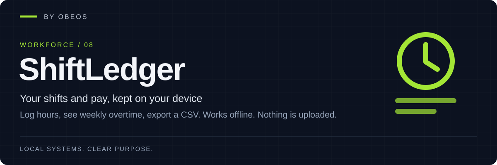

<div align="center">



**Log your shifts, see weekly overtime and estimated pay, export a CSV. Works offline. Nothing leaves your browser.**

[](https://github.com/5K-bit/ShiftLedger/actions/workflows/ci.yml)


[](LICENSE)

</div>

[Demonstration](#demonstration) · [Quick start](#quick-start) · [Tests](#tests-and-evidence) · [Limitations](#limitations)

---

## Overview

ShiftLedger is a small installable web app for people paid by the hour. Enter each shift (employer, start, end, unpaid break, rate) and it keeps a ledger, works out **weekly overtime** and **estimated pay to the cent**, and exports a **CSV** or a **JSON backup**. It runs entirely in your browser, stores data in IndexedDB, and keeps working with no connection once loaded.

Part of the OBEOS projects (Workforce, 08), and it works completely on its own. No server, no account, no analytics, no network requests: the page's Content Security Policy forbids them and a browser test checks it.

> **Your backup file is your only guarantee.** Browsers can clear site data (storage pressure, "clear cookies and site data", some privacy modes). Export a backup now and then. See [Limitations](#limitations).

> **Assumption.** ShiftLedger was built without a written product brief. It is an offline shift and pay ledger; if you wanted something different, the core (`src/core`) is plain, tested TypeScript that is easy to reshape.

## Demonstration

A made-up week, imported from CSV with the default settings (Monday start, overtime after 40 hours at 150%). Recorded by a test: [docs/evidence/demo-week.txt](docs/evidence/demo-week.txt).

```text
week of 2026-10-26: paid 48h 00m, regular 40h 00m, overtime 8h 00m, total $1,040.00
  shift: regular 10h 00m = $200.00, overtime 0h 00m = $0.00     (Mon-Thu, four of these)
  shift: regular 0h 00m = $0.00, overtime 8h 00m = $240.00      (Fri: all overtime, 8h x $20 x 1.5)

by employer:
  Corner Cafe: 4 shift(s), 40h 00m, $800.00
  Depot: 1 shift(s), 8h 00m, $240.00
```

Screenshots from the browser tests: [Summary](docs/evidence/screens/summary.png) · [Shifts](docs/evidence/screens/shifts.png).

## Quick start

**Requirements:** Node.js 22 or newer.

```bash
git clone https://github.com/5K-bit/ShiftLedger && cd ShiftLedger
npm ci
npm run dev          # http://localhost:5173
npm run build        # static site in dist/, with an offline service worker
npx vite preview     # serve dist/ locally (the service worker only runs from a build)
```

`dist/` is plain static files: host it anywhere that serves HTTPS (or `localhost`), or open the preview and use your browser's "Install" option.

| Tab | What it does |
|---|---|
| Shifts | Add, edit, delete (with confirmation). Overlapping shifts are flagged, not blocked |
| Summary | Per-week hours, overtime and pay; totals by employer; all-time total |
| Settings | Week start (Mon/Sun), overtime threshold in hours (0 = off), overtime percent (100–400), currency code |
| Backup | JSON backup/restore, CSV export, CSV import (adds shifts), delete all data |

## Architecture

```
index.html (CSP) ─► src/main.ts ─► ui/app.ts ──► core/  calc · csv · backup · model · time   (pure, tested)
                                       │
                                       └────────► storage/db.ts  (IndexedDB)
build: vite ─► dist/ ─► scripts/build-sw.mjs ─► dist/sw.js (precache, cache named by content hash)
```

Dates are local `YYYY-MM-DDTHH:mm` strings, durations are real elapsed time (daylight-saving aware), and money is integer cents. Details: [docs/architecture.md](docs/architecture.md) · [threat model](docs/threat-model.md) · [docs/adr/](docs/adr/).

## Tests and evidence

```bash
npm run lint && npm run typecheck
npm test                 # unit tests with a coverage floor
npm run e2e              # builds, then drives the real app in Chromium
```

Last recorded runs: [unit](docs/evidence/unit-run.txt) (87 tests, 97.8% statements) and [browser](docs/evidence/e2e-run.txt) (11 tests).

| Claim | Evidence |
|---|---|
| Pay, overtime, rounding and week boundaries are exact, including daylight-saving days | [`tests/unit/calc.test.ts`](tests/unit/calc.test.ts), [`time.test.ts`](tests/unit/time.test.ts), [golden demo week](tests/unit/demo-week.test.ts) |
| Input is validated; hostile CSV and backups are refused without changing data | [`model.test.ts`](tests/unit/model.test.ts), [`csv-backup.test.ts`](tests/unit/csv-backup.test.ts) |
| Bulk writes are all-or-nothing | [`db.test.ts`](tests/unit/db.test.ts) |
| Service worker precaches every built file | [`sw.test.ts`](tests/unit/sw.test.ts) |
| Data survives reload; works offline; makes no foreign requests; hostile text stays inert; backup round-trips | [`e2e/app.spec.ts`](e2e/app.spec.ts) |

The coverage floor (lines/statements 90%, functions 90%, branches 85%) applies to `src/core` and `src/storage`. The UI layer (`src/ui`) is exercised by the browser tests, not counted in the floor.

## Limitations

- **Storage is the browser's.** Clearing site data deletes your ledger. Export backups; ShiftLedger asks the browser for persistent storage but cannot force it.
- **Estimates, not payslips.** Overtime follows one simple rule: weekly threshold, one multiplier. No daily overtime, double time, tax, tips, deductions or rounding rules of a particular employer or jurisdiction.
- **A shift belongs to the week in which it starts**, even if it ends after midnight into the next week.
- **One currency at a time**, and a shift is at most 24 hours. Time zones are the device's; changing zone later reinterprets stored local times.
- **No sync between devices.** Use backup and restore.
- Tested in Chromium. Other modern browsers should work but are not in CI.

## Roadmap

- Per-employer rates and rules.
- Print-friendly weekly report.
- Pin versions and publish `v0.1.0` once CI has stayed green.

## Development practice

AI tools assist with implementation, debugging, tests and documentation in this project.
Louis Boddie owns direction and acceptance decisions; the linked tests and [evidence](docs/evidence/) document what is verified.

## Contributing

Issues and pull requests are welcome. See [CONTRIBUTING.md](CONTRIBUTING.md) and [SECURITY.md](SECURITY.md).

## License

[Apache-2.0](LICENSE) © 5K-bit
